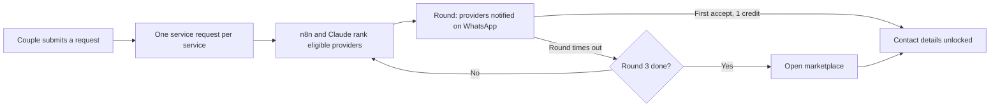

# Wedding Matching App

[](https://github.com/Lotmanine/wedding-matching-app/actions/workflows/ci.yml)

A two-sided wedding-services marketplace: a couple submits one request, and the platform finds local providers for each service through timed matching rounds. Providers pay with credits to unlock a couple's contact details.

This is a **portfolio project and a public demo**. The cities (USA and France), businesses, couples and phone numbers are fictional, and the demo checkout takes no real payment.

**Live demo:** <https://wedding-app.oldev.site>

The app is available in English and French. Demo data is restored every day.

## Demo logins

The demo accounts are shown on the login pages (`/provider/login` and `/admin/login`), with a button that fills in the form.

| Account | E-mail | Password |
|---------|--------|----------|
| Provider (New York) | `demo.provider@example.com` | `demo1234` |
| Provider (Paris) | `demo.prestataire@example.com` | `demo1234` |
| Administrator | `demo.admin@example.com` | `demo1234` |

## How the matching works

A wedding request is split into one service request per service (photo, catering, venue...). For each one, Laravel exposes the eligible providers, and an n8n workflow asks Claude to rank them. The top providers (3 by default) are notified on WhatsApp and have 120 minutes to respond. The first to accept pays one credit and gets the couple's contact details. If nobody accepts, the next round starts with different providers. After 3 rounds, the request opens to every eligible provider on the marketplace.



## Stack

- PHP 8.2+, Laravel 12, Livewire 4, Tailwind CSS, Vite
- MySQL or MariaDB, with Redis for cache and sessions in production
- Laravel Sanctum for API tokens, Spatie Permission for roles
- n8n for the automations, the Claude API for ranking, the WhatsApp Cloud API for messages
- Chargily Pay for online payments outside demo mode
- Docker image and Coolify deployment files in `deployment/`

## Notable engineering

- **Round state machine.** `RoundStateMachine` drives each service request through `new`, `round1` to `round3`, `matching` between rounds, and `open_marketplace`, ending in `accepted`, `expired` or `deleted`. The scheduled `wedding:advance-rounds` command closes timed-out rounds every 5 minutes, independently of n8n.
- **Credits ledger with transactions.** `CreditsService` locks the provider's row inside a database transaction and writes each movement to `credit_ledger` with the resulting balance. Accepting a lead locks the service request too, so only one provider can win it.
- **Signed webhooks with queued retries.** Domain events reach n8n through queued jobs, signed with HMAC-SHA256. A delivery gets up to 6 tries with exponential backoff, is logged in `webhook_deliveries`, and can be replayed from the admin area or the command line.
- **Sanctum API for n8n.** n8n reads candidates and drives rounds through a versioned `/api/v1` API, protected by a token ability and rate limits.
- **EN/FR.** The language switch covers the public site, provider area and back office. Prices follow the city: EUR in France, USD in the USA.
- **Structured logging.** `App\Support\Logger` writes JSON events to a dedicated channel and redacts common personal fields.
- **Tests.** 299+ PHPUnit tests cover matching, credits, webhooks, the API, the admin area and demo mode.

## Run locally

You need PHP 8.2+, Composer, Node.js and a MySQL or MariaDB database named `wedding_app` (see `.env.example`).

```bash
composer setup   # installs dependencies, creates .env and the app key, migrates, builds assets
composer dev     # server, queue listener, log viewer and Vite
composer test    # full test suite (in-memory SQLite)
```

To load the demo data, set `WEDDING_DEMO_MODE=true` in `.env`, then rebuild the database. This erases its current content.

```bash
php artisan migrate:fresh --seed
```

Demo mode loads the sample accounts and requests, shows the logins on the login pages, and replaces the payment gateway with a test checkout that grants credits immediately. Without it, the seeders load local development data and an `admin@example.com` / `password` administrator.

## More documentation

- [`docs/API.md`](docs/API.md) and [`docs/API_WEBHOOK_PAYLOADS.md`](docs/API_WEBHOOK_PAYLOADS.md): API and webhook contracts
- [`docs/OPERATIONS.md`](docs/OPERATIONS.md), [`docs/SECURITY.md`](docs/SECURITY.md), [`docs/SCALING.md`](docs/SCALING.md): running the app
- [`docs/DEPLOYMENT.md`](docs/DEPLOYMENT.md) and [`deployment/RUNBOOK.md`](deployment/RUNBOOK.md): deployment
- [`n8n/README.md`](n8n/README.md): the n8n workflows

## Author

Built by **Lotfi Otmanine**, senior WordPress developer at [OLDEV](https://oldev.site).

- Website: [oldev.site](https://oldev.site)
- Hire me on Upwork: [upwork.com/freelancers/~01bd748fcb665b90ca](https://www.upwork.com/freelancers/~01bd748fcb665b90ca)
- LinkedIn: [linkedin.com/in/lotfi-otmanine](https://www.linkedin.com/in/lotfi-otmanine)
- GitHub: [github.com/Lotmanine](https://github.com/Lotmanine)
- Case study: [oldev.site/work/27-wedding-matching-app](https://oldev.site/work/27-wedding-matching-app/)
